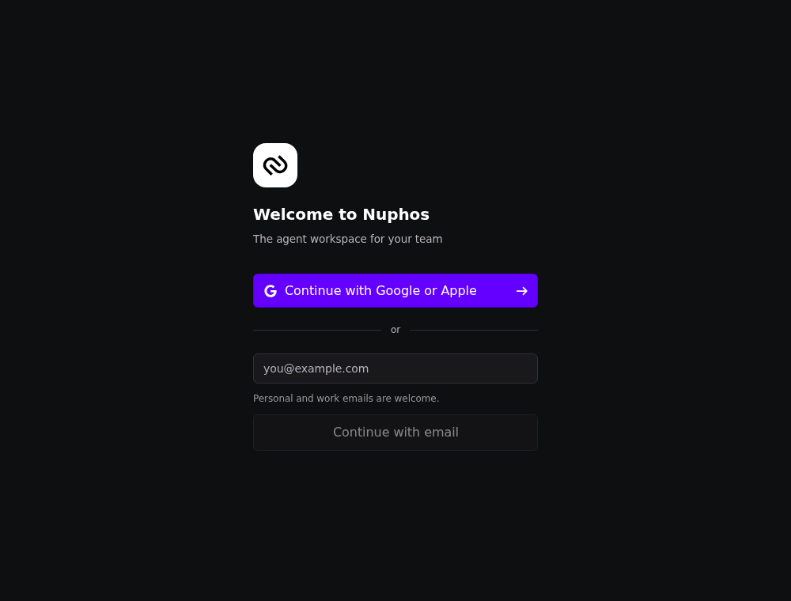
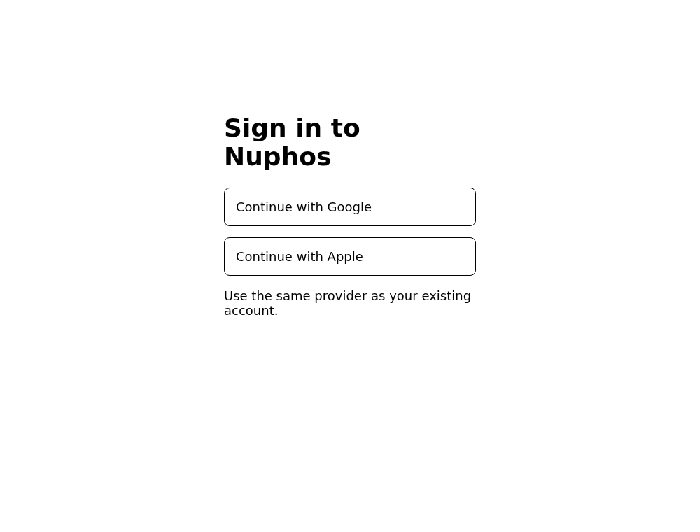

# Google and Apple sign-in across clients

Tracks https://github.com/nuphos/nuphos/issues/700.

## Clients and contract

The shared backend hosts `/auth/social/login`. It offers Google and Apple in a
system browser, so the same provider flow works on desktop (macOS, Windows,
Linux), iOS, Android and CLI. The native apps register
`POST /auth/native/session` with an S256 challenge and open the chooser with the
returned opaque `handle`. Desktop, Android and CLI retain their loopback listener;
iOS uses the exact `nuphos://google-callback` URI with ASWebAuthenticationSession.
Only a one-time delivery code and the original client state reach the callback.
The process that registered the attempt redeems the code with its in-memory
verifier. Session tokens never appear in native callback URLs.

The browser-only entry point (no handle) authenticates using a Secure, HttpOnly,
SameSite=Lax `__Host-nuphos-social` cookie. `/auth/social/session` returns the
current browser user, never the session token. This does not change the separate
`nuphos-landingpage` repository or its existing session cookie contract. That
website must integrate this endpoint before its own UI can offer Apple login.
No cross-origin redirects or arbitrary return URLs are accepted.

The chooser's `X-Nuphos-Social-Providers` header lists the configured providers
(for example `google,apple`). The desktop reads it before registration, shows a
"Continue with Google" button and, only when Apple is listed, a "Continue with
Apple" button, and opens `/auth/social/<provider>/start?handle=...` directly.
Without the header it retains its legacy Google login fallback for older servers. The CLI honors `NUPHOS_LOGIN_URL` as a
full provider chooser URL; its default now follows the selected API endpoint
rather than `NUPHOS_WEB_URL`. Deploy the backend before mobile/CLI
updates; those clients require the new chooser.

## Security decisions

Provider exchanges run only on the server. The backend validates RS256
signatures using provider JWKS, an allowlisted issuer, client audience, expiry,
issued-at time, subject and nonce. The browser's Secure, HttpOnly SameSite=None
correlation cookie binds the single-use state to the initiating browser, including
Apple's cross-site `form_post`. State records expire after ten minutes, with both
an explicit expiry check and a MongoDB TTL index. Provider errors are not echoed
to callbacks. Sign-in responses are not cached and suppress Referer headers.

Native PKCE and delivery-code checks remain independent: the verifier proves who
registered the attempt, while the code proves who received the browser redirect.
An intercepted iOS scheme callback cannot redeem without its verifier. An arbitrary
scheme/path cannot be registered. Prefer claimed HTTPS links in a future app-link
migration; this change preserves the installed iOS scheme.

Provider subjects (`googleID`, `appleID`) identify accounts. Apple private relay
addresses are accepted when verified, and repeat Apple sign-ins work without a
new email/name claim. Matching email never silently links accounts in the new
flow; use the existing account method instead. The old Google exchange endpoint
is retained for compatibility and keeps its existing linking behavior.

## Provider setup and rollout

1. Set `NUPHOS_AUTH_BASE_URL` to the public HTTPS backend origin. HTTPS is required
   for the browser-binding cookies, including local interactive testing.
2. Configure `GOOGLE_OAUTH_CLIENT_ID` / `GOOGLE_OAUTH_CLIENT_SECRET` for a web OAuth
   client and register the exact backend callback
   `https://<backend>/auth/social/google/callback`. Keep any existing website
   callback registered while legacy clients remain supported.
3. Configure an Apple Services ID associated with the app's primary App ID and
   enable Sign in with Apple. Set `APPLE_OAUTH_CLIENT_ID`, `APPLE_OAUTH_TEAM_ID`,
   `APPLE_OAUTH_KEY_ID`, and `APPLE_OAUTH_PRIVATE_KEY` (P8 PEM, literal or escaped
   newlines). Register the backend domain and the exact HTTPS return URL
   `https://<backend>/auth/social/apple/callback`.
4. The Apple client-secret JWT is ES256, generated server-side for five minutes.
   The P8 key and all provider credentials stay off clients and out of Git.
5. Configure Apple's private email relay sender registration for OTP/account
   deletion mail. Verify cancellation, existing accounts, relay addresses, MFA,
   browser cookie restrictions, app switching and replay on real devices.
6. Deploy backend/indexes first, then desktop/mobile/CLI. No cloud/provider
   configuration or production deployment is performed by this PR.

Account deletion already uses an operator-assisted purge runbook. Apple grant
revocation must be included in that runbook before production enablement. This PR
does not retain Apple refresh tokens, implement automatic grant revocation or
process Apple server-to-server account notifications. Live provider/device tests
require configured clients and interactive test accounts and are not replaced by
mocked tests.

## Research

- [RFC 8252: native apps use an external user agent and PKCE](https://www.rfc-editor.org/rfc/rfc8252)
- [Google OAuth for native applications](https://developers.google.com/identity/protocols/oauth2/native-app)
- [Google OIDC token validation](https://developers.google.com/identity/openid-connect/openid-connect)
- [Apple user verification](https://developer.apple.com/documentation/signinwithapple/verifying-a-user)
- [Apple authentication flow](https://developer.apple.com/documentation/signinwithapple/authenticating-users-with-sign-in-with-apple)
- [Apple token revocation](https://developer.apple.com/documentation/signinwithapplerestapi/revoke-tokens)

## Validation

- Backend: `bun test src/lib/identity/social.test.ts src/routes/auth-social.test.ts src/lib/native-auth.test.ts src/routes/auth-native.test.ts`
- Backend: `bun run typecheck`, `bun run lint`
- Desktop: `pnpm typecheck`, `pnpm test`
- iOS: `bash tests/social-login.sh`, simulator build with signing disabled
- Android: `./gradlew testDebugUnitTest lintDebug assembleDebug` (requires Java/Android SDK)
- CLI: `cargo check --locked`
- Repository: `bun run check:cycles`, `bun run format:check`

## Review screenshots

Captured locally from the actual desktop `LoginView` component (with the Electron API stubbed) and the backend chooser response; these show the sign-in surfaces, not a live provider round trip.

Browser sign-ins use the same revocable server-side sessions and new-sign-in alerts as other authentication methods. Native callbacks create no session until the client redeems its one-time delivery code with PKCE.
