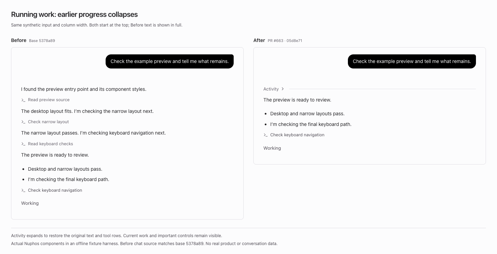
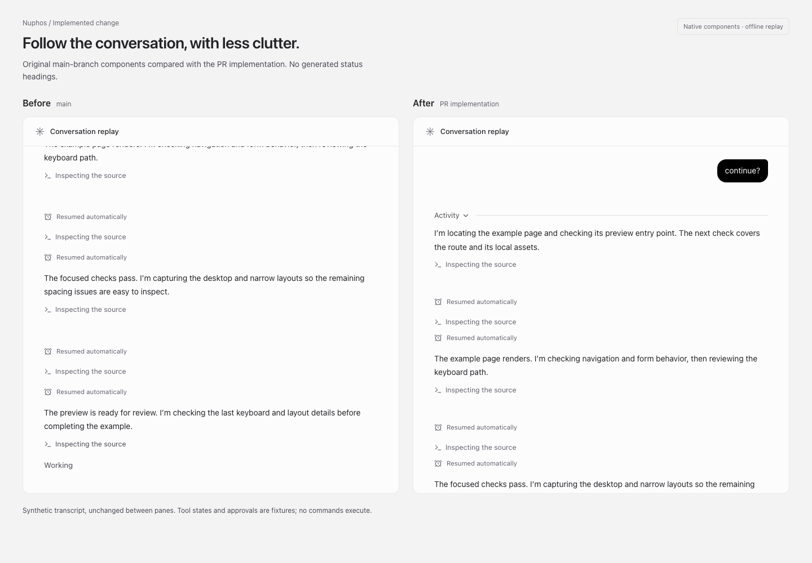
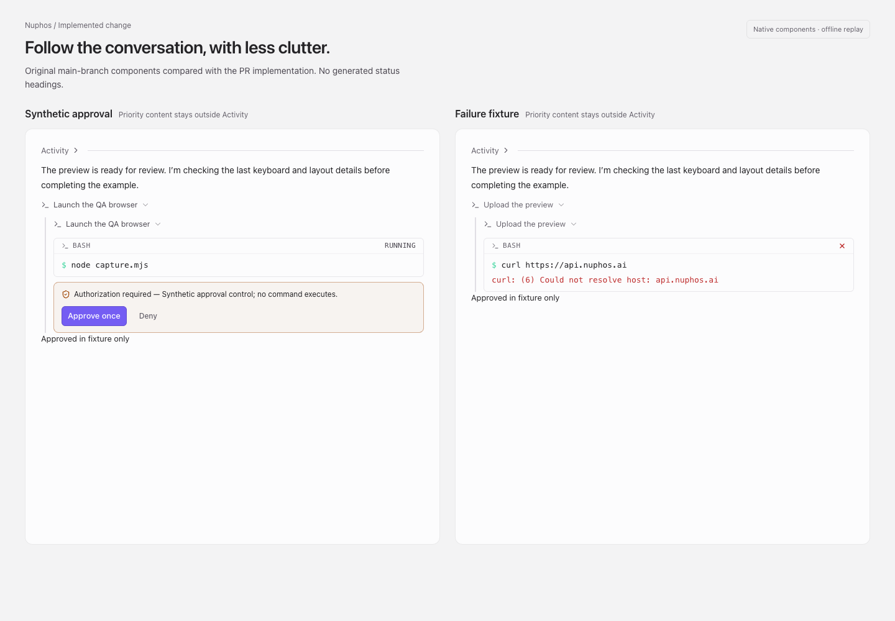
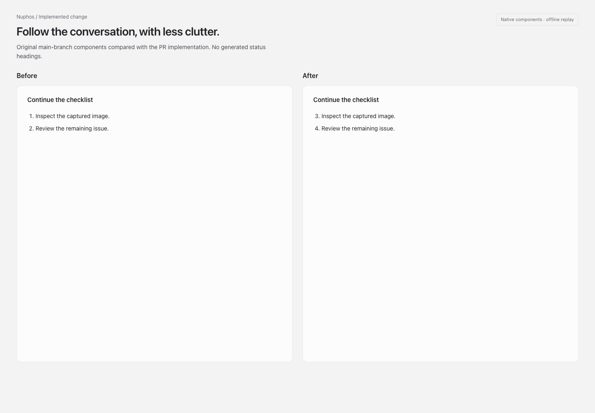
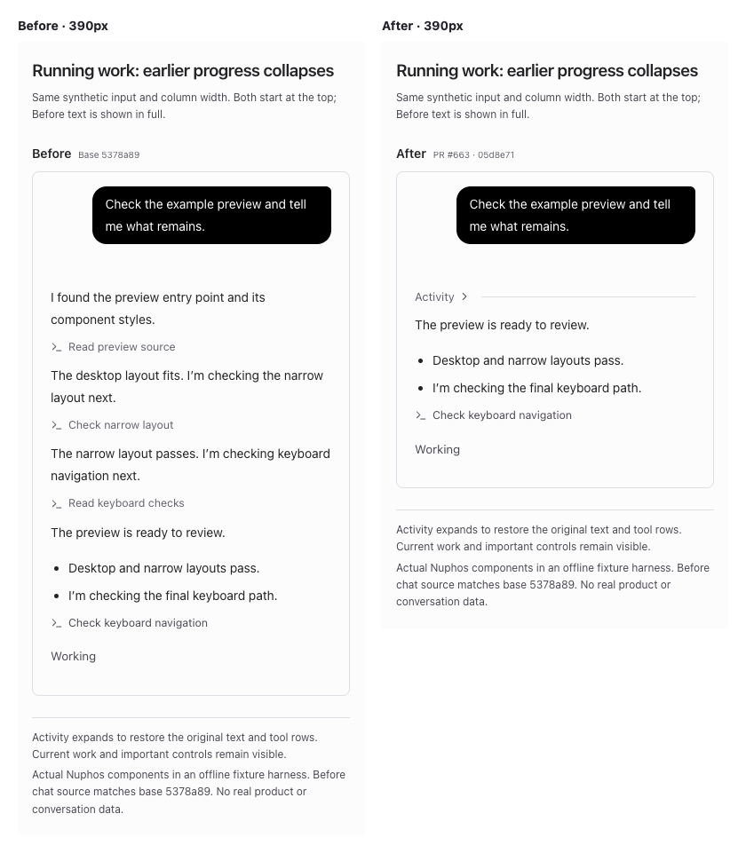

# Chat activity presentation

Proposed on `feat/chat-activity`; no deployment is implied.

Earlier explicit commentary and successful plain tool calls share an expandable
Activity row. The newest text, final answers, active calls, approvals, failures,
user steering, cards and files remain visible. Expanding restores original text,
message IDs, controls and timestamps. This changes presentation, not how much the
model writes. Unknown phases are not guessed or rewritten.

`openab-text-updates.ts` retains native messageId and the recognized Codex phases
commentary/final_answer. `preview-transcript.ts` preserves message boundaries;
the prompt and autonomous routes emit matching text-start frames. Desktop
applyEvent, persistence and toUiMessages preserve these fields through stream,
reload, request and transcript sync. Legacy framing is retained. Existing
mid-turn credential renewal and runtime-output token redaction from main remain intact.
The redaction buffer keeps ordinary text ownership across native message boundaries;
if one redacted credential spans owners, its sanitized output stays unphased
instead of guessing a source-message classification.

`panel/activity.ts` owns grouping and protects user/timeline/file boundaries.
`renderPartRange.tsx` selects parts before constructing tool runs, preventing
empty or duplicate headers. ToolRunView, ToolPartView and turnFold keep explicit
failures and approvals visible, including interrupted turns and structured
nonzero exit codes. SessionFindBar explains how to search collapsed activity.
Continued ordered Markdown lists keep their starting number.

The screenshots use light-theme native components with explicitly synthetic
transcript/tool fixtures, not installed-app captures. No product content appears.

