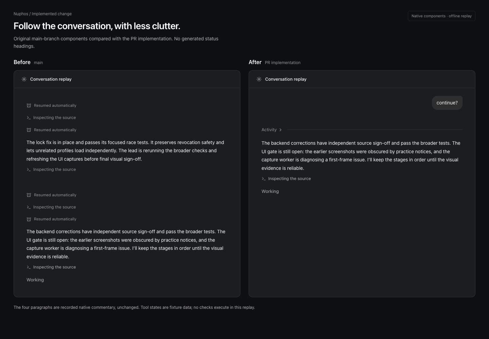
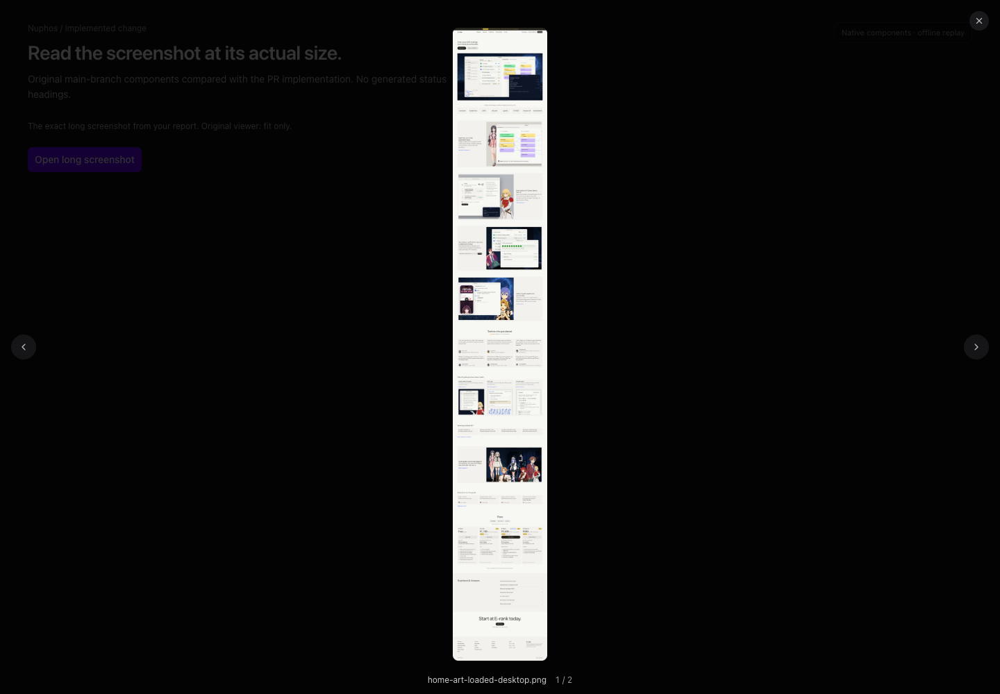
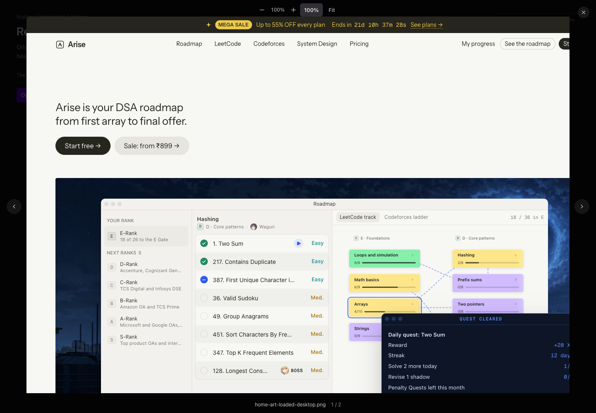
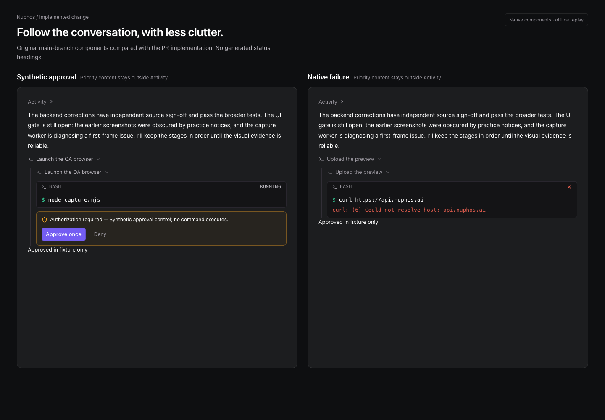
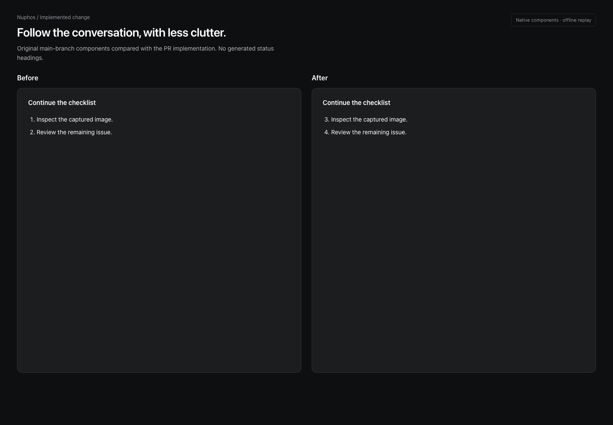

# Conversation readability and image zoom

This document describes the proposed implementation on `feat/chat-readability`;
it is not evidence that the change is deployed.

## What changes

- Earlier explicit commentary and successful plain tool calls share an expandable
  Activity disclosure. The newest text remains visible. No generated status title
  or rewritten summary replaces the agent’s words.
- Active calls, approvals, failures, final answers, user steering, plan/decision
  cards and attached files retain their own visible place. Expanding Activity
  restores the original message IDs, text, tools, feedback and timestamps.
- Still-image previews add zoom buttons, actual pixels (100%), Fit, double-click,
  pointer dragging, trackpad/touch pinch, and keyboard zoom/panning. Image arrows,
  close, caption and download use the existing lightbox. Video is unchanged.
- Ordered Markdown lists preserve their starting number, including a list
  continuing at 3. Headings, bullets, emphasis, tables and code already render.

## Source contract

`openab-text-updates.ts` accepts only the native `messageId` and
`_meta.codex.phase` values `commentary` / `final_answer`. `preview-transcript.ts`
keeps adjacent native message boundaries, and the prompt/autonomous routes emit
`text-start` when those boundaries change. Desktop `applyEvent.ts`,
`persistence.ts` and `toUiMessages.ts` retain these fields through stream, reload,
request and transcript sync. Legacy streams keep their original framing.

`panel/activity.ts` owns grouping. Unknown text phases stay visible; no keywords,
paragraph length or guessed semantics classify an answer. Grouping never crosses
human messages or timeline events, and download-bearing messages are protected.
`renderPartRange.tsx` filters selected parts **before** constructing tool runs,
so a hidden call cannot leave a duplicate run header outside Activity.

`ToolRunView.tsx`, `ToolPartView.tsx` and `turnFold.ts` keep explicit failures
attention-worthy, including nonzero structured exit codes and interrupted turns.
`SessionFindBar.tsx` tells users to expand Activity to search its contents; it
still searches rendered content rather than a new transcript index.

`ZoomableImage.tsx` composes the existing Dialog/Button surface. The scroll anchor
captures offsets **before** the image changes size, avoiding browser clamping
moving the zoom target. `imageZoom.ts` contains the pure geometry calculations.

## Limits

This changes presentation, not the amount the model writes. Old transcripts and
providers without native phase metadata use the conservative existing display.
It does not deduplicate server events, rewrite verbose answers, or add tool-image
transport/hover previews. Image zoom applies wherever desktop uses ImageLightbox;
iOS/Android native viewers are outside this PR. The 390px checks exercise the
responsive desktop renderer, not a native phone app.

## Visual evidence

The captures use frozen main components at `bfc95da` and the PR’s actual
components. Both render offline without backend requests. The commentary excerpt
and long image came from real review material; tool states and approval controls
are fixtures and do not execute commands. The numbered list is a focused fixture.
The outer comparison page is review scaffolding, not proposed product chrome.
The branch was then updated to `ede5ecf`; those upstream changes do not touch
the renderer in the captures.

| Original fit-only viewer                                | Zoom to actual pixels                                         |
| ------------------------------------------------------- | ------------------------------------------------------------- |
|  |  |

