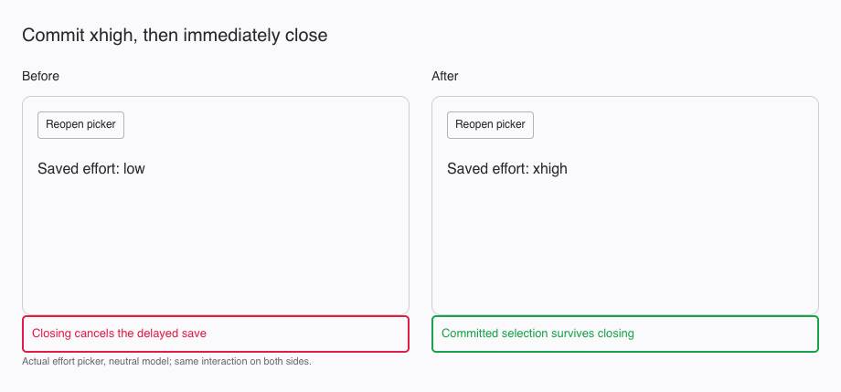
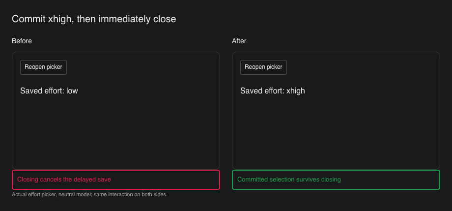
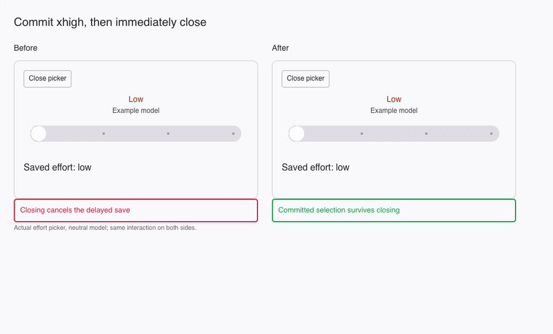

# Effort picker save timing

`ModelEffortPanel` sends a committed level immediately. A committed value must reach `SessionConfigSync` before closing the popover unmounts the picker. Previously a350ms timer was canceled by unmount, losing a chosen xhigh value and reopening at the previous level.

The slider still keeps its local draft while dragging, ignores committing the already-selected stop, and disables during a save. The existing config synchronizer handles acknowledgment, failed saves, queued busy-session picks and stale reads. This fix does not invent a confirmed runtime value.

Verification:14 existing config-sync/effort tests pass. Actual before/after components were exercised in a browser in light and dark mode: End selects xhigh, immediate close loses the value before and preserves it after; reopening restores xhigh, repeating End makes no extra save, and Home commits low. Desktop build/typecheck and focused lint pass. Evidence uses a neutral model and no product data.

