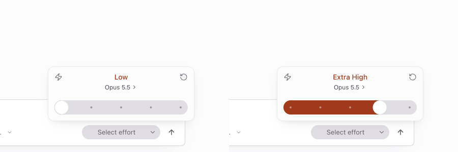
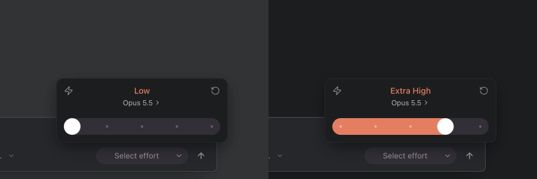

# Effort picker save timing

Closing the picker used to cancel a pending save, reverting a new effort selection. Effort commits now coalesce rapid keyboard steps for 350 ms and flush the final committed stop when the picker closes. Returning to the acknowledged stop cancels the pending change. Runtime acknowledgments and errors still use the existing config synchronizer.

Verification: 17 focused scheduler, config-sync and effort tests; desktop build/typecheck; focused lint with no errors. Actual Electron app checks in light and dark used the same native sequence: Low, three ArrowRight presses, Escape, reopen. The unchanged app persisted Low; the fixed app persisted xhigh through the real backend/runtime.

The screenshots and recordings use full application builds, a local backend/database/runtime, and neutral seeded messages. They contain no added labels or readouts. Before is left, after is right in the matching crops. Full app captures and recordings are linked below.

[Before recording](images/effort-picker/before-app.gif) · [After recording](images/effort-picker/after-app.gif)

[Full light before](images/effort-picker/light-before-full.png) · [Full light after](images/effort-picker/light-after-full.png) · [Full dark before](images/effort-picker/dark-before-full.png) · [Full dark after](images/effort-picker/dark-after-full.png)
