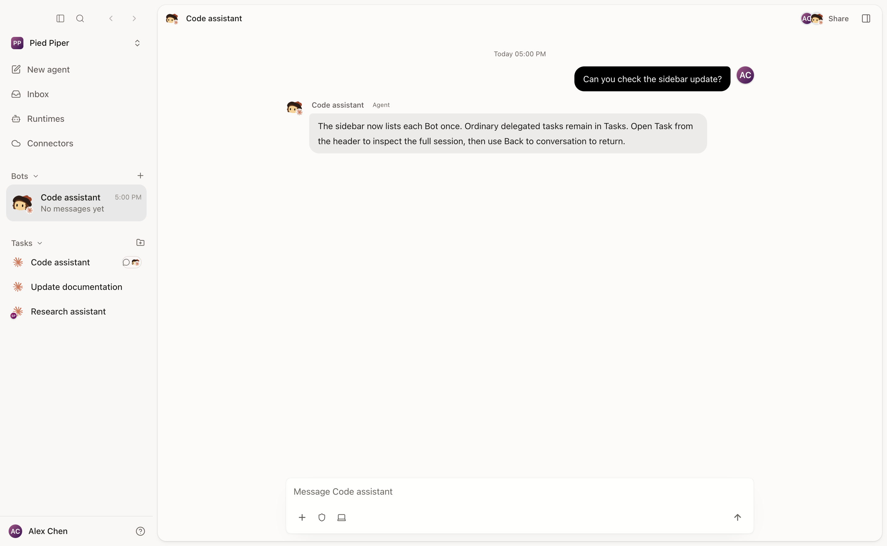
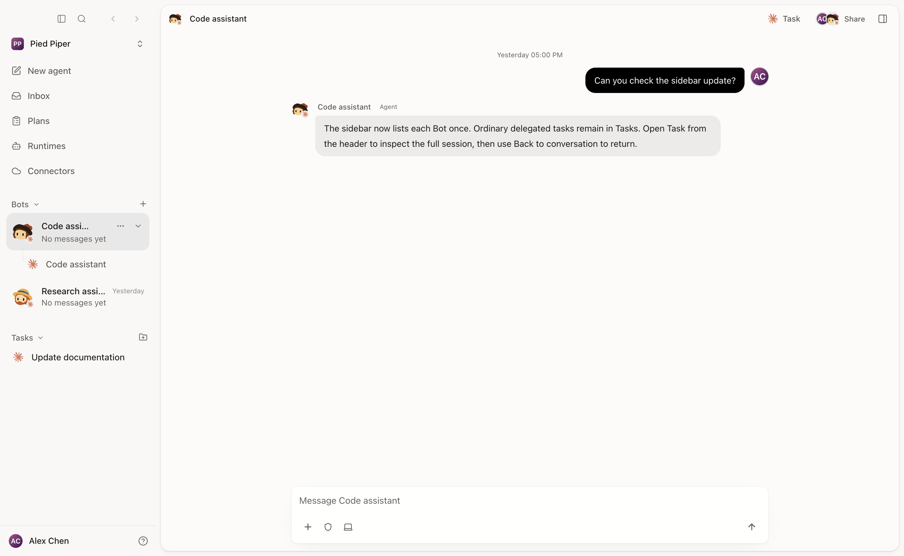
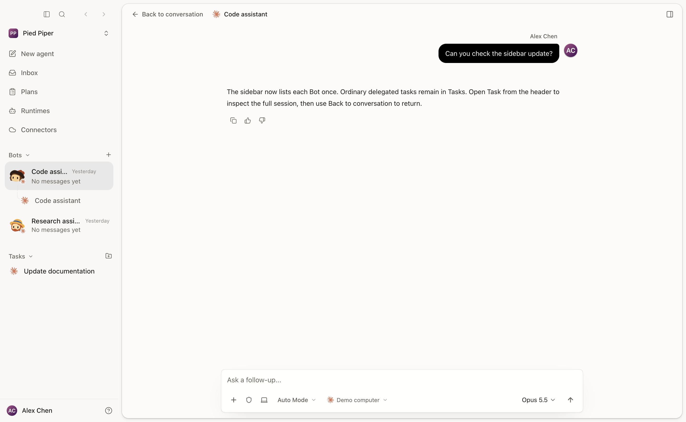
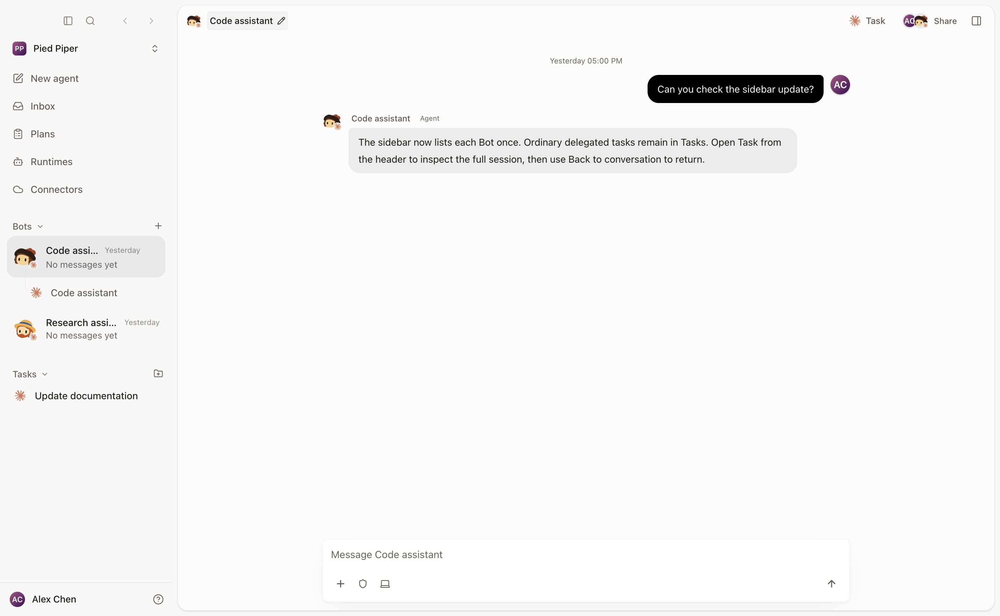

# Bot task mode — real Desktop evidence

Captured on macOS in Electron 44.10.0, light theme. These replace the earlier
component-only previews. The complete `src/main.tsx` application, sidebar,
channel conversation, Task transcript and composer are the real Desktop
components; none are replaced with illustrative markup or stand-ins.

Only API/IPC responses are deterministic synthetic fixtures: Pied Piper, Alex
Chen, an owned Code assistant with a 1:1 chat, a teammate's Research assistant
without a chat, and an ordinary Update documentation task. All network access
outside the local Vite server is blocked. No production accounts, messages,
credentials or customer information are included.

Before uses the original production source at
`f8f5eab12c89f73a5f0555b9df3115950d13e4ef`; after uses this branch with main
`cd893d69771da0a5ef6bbf4996e3695523d92161` integrated and the read-only
Bot Task access fix. The same fixture responses drive both.
Playwright launches Electron and captures its actual window content. The GIF
records opening Task, Back to conversation, reopening Task and Back again.

## Before

## After and Task entry

## Temporary Task mode

## After Back

## Open, Back and reopen

