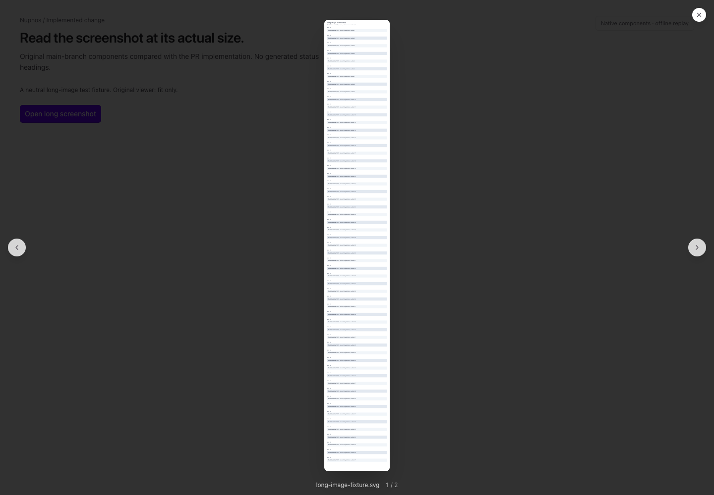
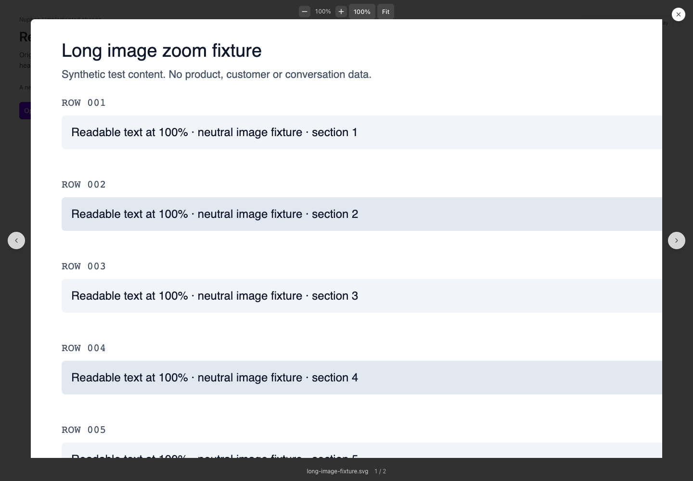
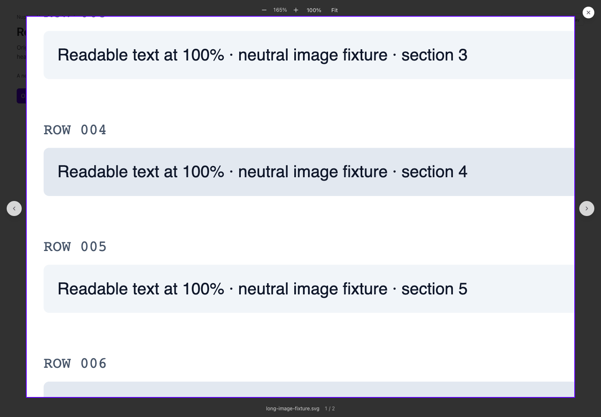
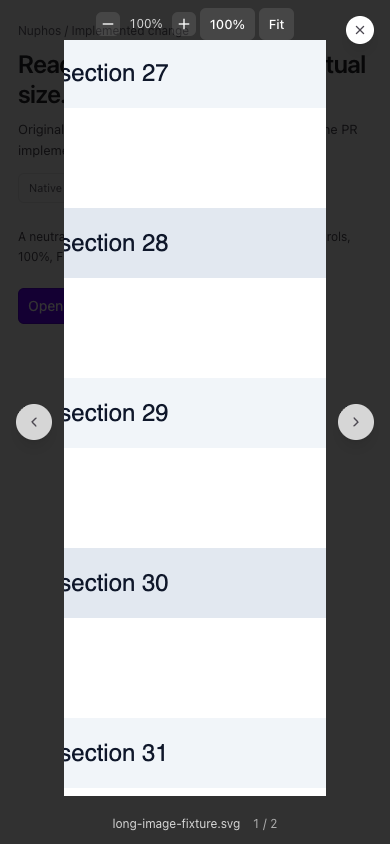

# Image preview zoom

Proposed on `feat/image-zoom`; no deployment is implied.

The existing ImageLightbox composes ZoomableImage for still images. It adds
zoom buttons, 100% actual pixels, Fit, double-click, mouse drag, ordinary scroll,
trackpad/touch pinch, +/-/1/0 keys and arrow panning while enlarged. At Fit,
arrows still navigate the gallery. Switching images resets zoom. Caption,
download, Escape, close and mouse blank-area dismissal retain their behavior;
video uses its existing viewer.

ZoomableImage captures pointer/scroll anchors before image dimensions change,
so browser clamping cannot shift the zoom target. Fit-size mouse clicks do not
record uncaptured pointers; enlarged dragging and touch gestures use capture.
imageZoom.ts owns fit/zoom bounds and anchor geometry. Toolbar contrast remains
legible over the dark backdrop in both app themes. No image transport or API
contract changes are involved. Native iOS/Android viewers are outside this scope.

Evidence uses the neutral synthetic SVG in fixtures/long-image.svg and the
actual light-theme before/after components. It contains no product content and
is not an installed-app capture. The 390px view is the responsive desktop renderer.

| Before: fit only                                  | After: actual pixels                           |
| ------------------------------------------------- | ---------------------------------------------- |
|  |  |

