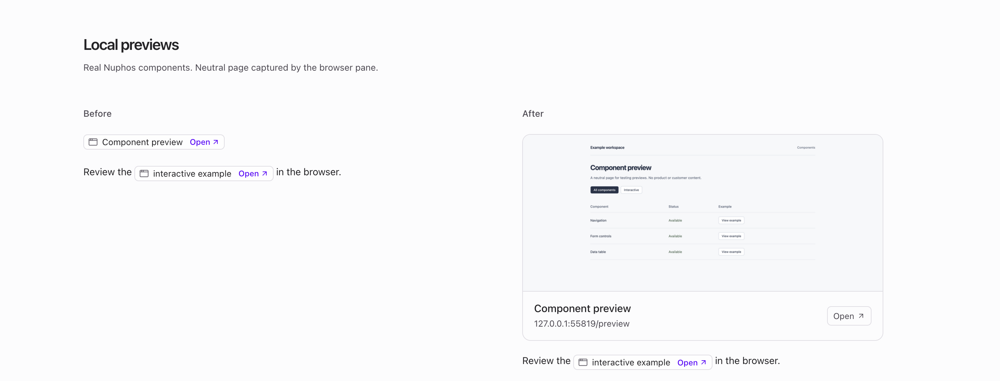
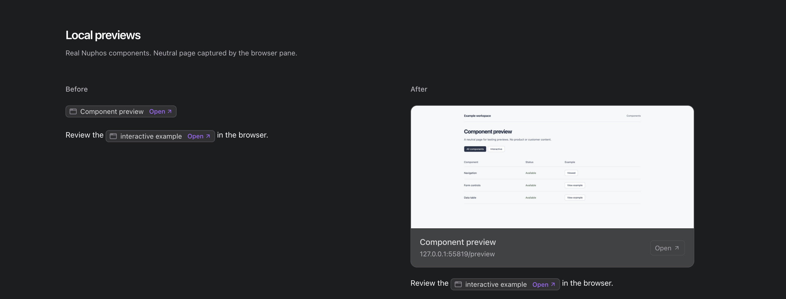
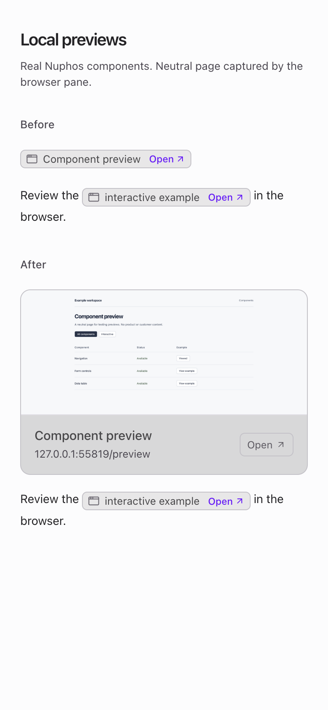
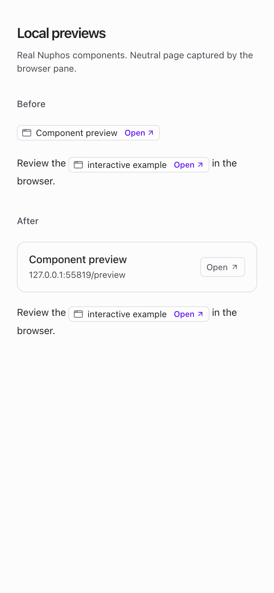
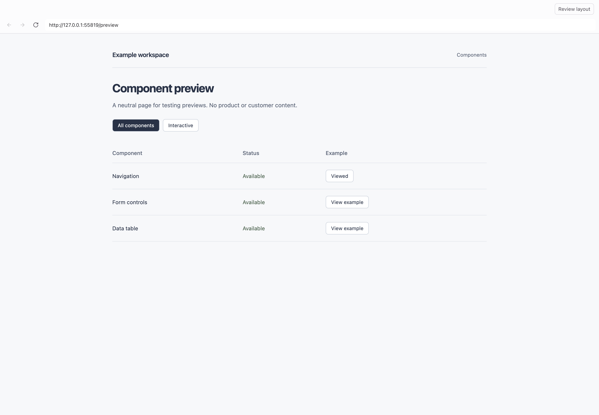

# Local page previews

Proposed on `feat/local-preview-card`; no deployment is implied.

Standalone local links and tool-discovered local URLs use a page thumbnail
above a quiet footer with the title, address and Open action. The thumbnail
comes from a real page already opened in Nuphos's browser pane. A URL without
an available capture keeps a compact footer. Links within prose retain their
original inline treatment.

MessageResponse uses standaloneLocalLink to identify a paragraph containing
only one validated local link and optional terminal punctuation. It asks the
existing renderer for standalone presentation; a declined renderer falls back
to the original children. useAgentLinks forwards the option and team scope to
useLocalUrlLinks. LocalUrlStrip uses the same LocalPreviewCard.

BrowserView captures a loaded, visible local page with capturePage; it does
not open additional pages to obtain thumbnails. The bounded snapshot cache
lives only in device memory and is keyed by current user, team and exact URL.
Snapshots are never uploaded, persisted in conversations, or sent to the agent.
Navigation, failed loads and browser unmount clear the browser-owned capture;
late capture results cannot restore it. Remote pages are never captured for
these cards. Missing/offscreen captures leave a working link.

The shared ChatLink preserves browser-pane routing, modifier-click and context
menus. Local URL validation, credential rejection and own-machine URL discovery
remain unchanged. A thumbnail is a captured page, not a server-health indicator.

Evidence uses neutral synthetic content with actual Nuphos components in an
isolated Electron harness. The thumbnail is a real NativeImage capture of a
live local fixture page in the production BrowserView, not a drawn mockup.
These are not installed-app captures. The neutral page source is
[available here](examples/local-preview.html). No product or customer material is used.

